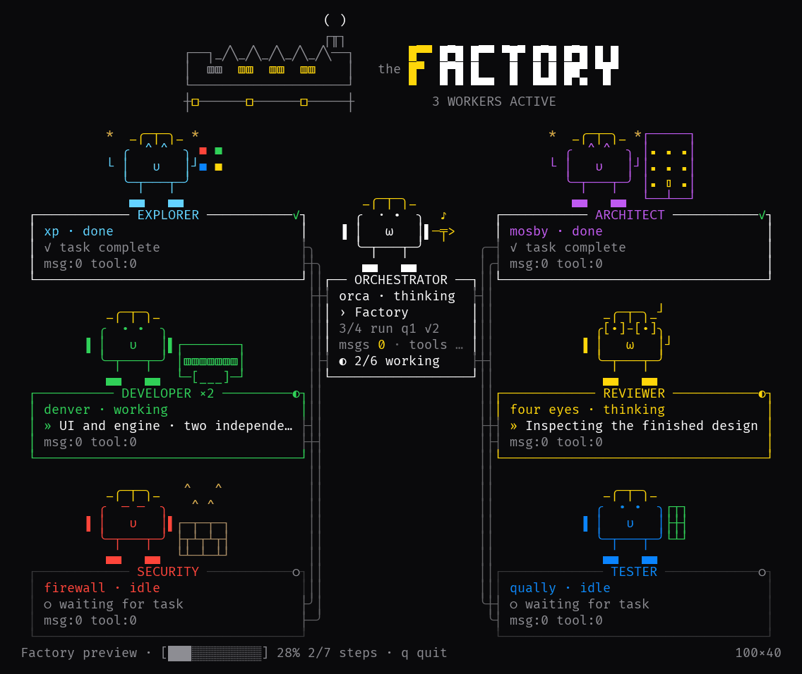

# theFactory 🏭

A zero-dependency terminal visualizer for an orchestrator agent and its six
subagents: **explorer**, **architect**, **developer**, **reviewer**, **security**
and **tester**.

Packets travel between the centre box and each pillar while agents work. Run
`thefactory` to type a task; it drives a real `opencode run` session and shows
all subagent traffic live.

On macOS, an optional native menu bar companion shows a small popover with live
progress and animated workers. Choose a directory, configure agents and launch
a prompt in Terminal directly from the popover. Build and open it with
`npm run macos:install`. See [the menu bar guide](macos/README.md).

## Requirements

- Node.js 22 or newer
- The OpenCode CLI, with Coarena keys or OpenCode Go authentication (or the free profile)
- A terminal of at least **60×24**

There are no npm dependencies and nothing to install.

## Quick start

```sh
node bin/theFactory.js                     # task mode
node bin/theFactory.js "fix the tests"     # prefill a task
node bin/theFactory.js --demo              # scripted demo
node bin/theFactory.js --live              # watch a real session
```

Optionally link the command:

```sh
npm link
thefactory
```

## Screenshots



- **Task** — type a task, press Enter, watch OpenCode work and the six pillars
  light up. This is the default in a terminal.
- **Demo** — a deterministic scripted workflow for trying the UI.
- **Live** — replay or follow an existing OpenCode session.
- **Snapshot** — plain-text frames for pipes and logs.

## Tiny factory crew

Each agent, including the orchestrator and auxiliary agents, has a chunky,
square little worker with a hard hat directly above its name. Six-pose animations
show tinkering/typing, thinking, breathing, a celebratory jump, or a confused
face on failure. Each worker has a name and a signature prop:

| Role | Name | Prop |
| --- | --- | --- |
| Orchestrator | orca | Tiny trumpet |
| Explorer | xp | Four-color Windows XP flag |
| Developer | denver | Keyboard with keys and a spacebar |
| Security | firewall | Staggered brick wall and flames |
| Architect | mosby | Building with windows and a door |
| Reviewer | four eyes | Square glasses |
| Tester | qually | Spreadsheet grid |

```sh
node bin/theFactory.js --worker-preview       # animated dumpling / bean / puff audition
node bin/theFactory.js --demo                 # selected dumplings in a demo session
node bin/theFactory.js --reduced-motion       # static expressive poses
```

The broad **square dumpling** is the selected design; the taller bean and
soot puff remain in the audition. [Selected crew](docs/worker-preview.gif)
and [three-design audition](docs/worker-audition.gif) are animated previews
rendered from the TUI canvas. Glyph appearance depends on the terminal font.

Workers occupy 16×5–6 cells; Denver, Firewall and Mosby expand to 22 cells when
their card has room for larger props. They share the existing render clock with independent
phases. Completion plays once and settles. No dependencies or per-worker timers
are added; the existing ANSI diff renderer updates changed cells. `NO_COLOR`
retains the shapes and expressions. Set `FACTORY_REDUCED_MOTION=1` or
`REDUCE_MOTION=1` to disable decorative movement, or use `--reduced-motion`.
`TERM=dumb` also selects reduced motion.

At **60×24**, compact cards retain each worker, name, and status alongside the
task composer. The skyline contracts when necessary; taller terminals restore
the feeds and skyline. Full messages remain available in `/log` (or `l` in
demo/live mode). With mouse reporting enabled, clicking a worker or compact
card also opens its log. See the [60×24 frame](docs/worker-preview-60x24.txt).
During a session, shrinking below the minimum shows a resize hint and keeps
the task running. Growing the terminal restores the view and packet routes.
The [TUI review](docs/TUI_REVIEW.md) records the frontend fixes and verification.

## Fira Code in macOS Terminal

Fira Code is selected by Terminal for the entire profile, including the TUI,
logs, prompt and configuration screens. Use the included
[theFactory Fira Code profile](config/terminal/theFactory-FiraCode.terminal):

1. Install the TTF fonts from the [official Fira Code release](https://github.com/tonsky/FiraCode/releases/tag/6.2) in Font Book if needed.
2. In Terminal, open **Settings → Profiles**, use the profile action menu to
   **Import**, and select `config/terminal/theFactory-FiraCode.terminal`.
3. Open a window with **Shell → New Window → theFactory — Fira Code** and run
   `thefactory`. The profile uses Fira Code Regular 14 at 120×42.

You can also select Fira Code directly under **Profiles → Text → Font → Change**
for your existing profile. The TUI cannot change a terminal font through ANSI
escapes. The supplied profile has no startup command and does not replace your
default profile. Decorative crew glyphs are covered by Fira Code 6.2; arbitrary
text from agents can still use macOS font fallback. Ligatures depend on terminal
support. See [profile details](config/terminal/README.md).

## Factory animation and parallel work

The factory uses an industrial sawtooth roof, stack exhaust, uniform window
bays and a production conveyor. Its angular wordmark has a restrained amber
accent. The building has no face. Motion follows real activity and respects
reduced motion; small headers use a compact factory mark.

The chimney emits visible rising puffs. Session labels reserve space around
the artwork so they cannot erase the smoke. At 60×24 with the task composer,
the crew and controls use the available rows; a taller window restores the skyline.

```sh
node bin/theFactory.js --factory-preview              # local animated preview
node bin/theFactory.js --task --parallel --workers 3   # plan and run independent work
```

Parallel mode honors task dependencies and declared file ownership. Independent
readers and disjoint writers overlap; conflicting read/write scopes serialize.
Workers share the target checkout, so file scopes are scheduling contracts rather
than isolated workspaces. Failed dependencies block their consumers, successful
outputs reach downstream tasks, and Esc cancels running and queued work. Any
failed/blocked task is reported as an incomplete run. The TUI shows concurrent
workers per role and live scheduler counts.

Investigation plans use the smallest useful team and only necessary dependencies;
the runtime already supplies the final overview. Scope paths are search hints:
a missing optional README or graph is a finding. If a read-only investigator
reports incomplete despite a successful process, the orchestrator can reassess
the supplied findings against that task's acceptance criterion once, without
tools. Approval requires supporting report lines; unavailable, invalid or negative
reviews retain the failure. Implementation/test failures remain blocking. The
original declaration, review and limitations are retained in saved state and
passed to dependent tasks and the overview.

The footer shows prompt progress from completed plan steps, including the final
overview. Parallel runs use the accepted task graph; native runs use OpenCode's
todo list when supplied. A run without a known step total shows an indeterminate
bar. Failed, blocked or cancelled work never produces a successful 100% result.

The orchestrator finishes with a scrollable overview of **Completed**, **Not
finished**, and **Verification**. Parallel runs add a text-only orchestrator
recap using every task outcome; the complete task record is retained if recap
generation fails. Cancelled runs show their recorded outcomes without starting
a recap request. The view opens automatically; Esc closes it and `/overview`
reopens it. Full worker output remains in `/log`.
See the [overview preview](docs/overview-preview.png).

Built-in [agent skills](skills/README.md) load from any target repository.
Implementation, terminal-interface and parallel-execution skills extend the
specialists' role contracts. Skill bodies go only to matching roles. Existing
system instructions, models and permissions are preserved in per-process
configuration; project skills can override built-ins by name.

## Task mode basics

| Key | Action |
| --- | --- |
| Enter | run the task |
| Esc | abort the running task |
| Ctrl-C | quit |
| `q` | quit only when the composer is empty |

Composer commands:

```
/new  /sessions  /resume [id|#n]  /fallback  /models  /volume  /config  /log  /overview
```

`/sessions`, bare `/resume`, and `thefactory --picker` open the conversation
browser. Each main conversation contains its native child sessions and deeper
descendants. New Factory-managed runs also record their planner, independent
workers, acceptance reviews and summary sessions as one conversation group.
Older standalone sessions without recorded membership remain separate; grouping
does not guess from similar titles or timestamps.

Use ↑/↓ to choose, →/← to expand/collapse, type to search, Tab to switch between
this project and all projects, and Enter to resume. Choosing a child resumes its
main conversation. The browser shows recorded outcomes, restores per-agent logs,
and supplies the child reports as bounded context for the next request. Browsing
does not dispatch work; switching conversations is disabled during an active task.

`/resume <id|slug|#n>` validates the selection and accepts parent or child IDs;
numbers refer to the last displayed conversation list. Missing/ambiguous IDs and
unavailable project folders leave the current conversation unchanged.
The separate CLI flag `--resume <dir>` still prints the safe recovery plan from
`parallel-state.json`; it never blindly reruns write tasks.

`/config` opens an editable card for the model, profile, verbosity, fallbacks,
auto-approve, parallelism, nolimit, graphify and sound volume settings.

The seven agent rows choose an independent **base model** for the orchestrator,
explorer, architect, developer, reviewer, security, and tester. Use ↑/↓ to
select a named agent row, then press Enter to open its model picker. The picker
lists each Coarena model once: Opus 5.5, Fable 5.2, GPT-6 Luna, Gemini 3.8
Flash, and DeepSeek V4.1 Flash 1017. Keys are selected automatically. ↑/↓ selects a model,
Enter applies it to that agent, and Esc cancels. Coarena choices remain visible
at the top even when the current model is far down the list; press **C** to
jump directly to them. Home/End selects the first/last model. ←/→ still cycles models.
Editing a model automatically
creates **Custom**, retaining the preset's effort level and every untouched
agent's model. The **all agents** row sets all seven agents together.

The profile row switches between presets and your saved Custom profile.
Selecting a preset keeps Custom available; editing a preset updates the
Custom slot. The active selection and complete Custom lineup persist in
`~/.config/thefactory/config.json` (or `$XDG_CONFIG_HOME/thefactory/config.json`).
Older per-agent settings are imported automatically. Changes apply to the next
task, including parallel workers, and temporary fallbacks never rewrite Custom.
Changing the profile immediately refreshes the displayed models and variants.
`--profile custom` selects the saved Custom profile explicitly.

## Sounds

`pop.mp3` plays when an agent is called (orchestrator → subagent, worker
starts, pillar tools), `error.mp3` on failures (failed tasks, tool errors,
pillar failures), and `completed.mp3` when a task finishes successfully.
`/volume` shows or sets the volume — `/volume 50`, `/volume mute`,
`/volume on`, `/volume +10` — and persists it across runs.
The `/config` card's `volume` row cycles `0 (muted) / 25 / 50 / 80 / 100`.
Flags: `--volume <0-100>`, `--mute` / `--no-sound`; env: `FACTORY_VOLUME`,
`FACTORY_SOUND=0`. Volume is passed to the audio player itself
(`afplay -v` on macOS, `ffplay -volume` / `mpv` / `mpg123` elsewhere); the OS
output volume is left untouched. Snapshot frames stay silent.

## Model profiles

With Coarena keys configured and the default profile, task mode starts on Claude Opus 5.5.
Choose a model once; theFactory starts with the highest populated, distinct key
and rotates downward on limits: key 4 → key 3 → key 2 → key 1 → the existing
OpenCode Go pool, keeping the same Coarena model throughout key rotation.
Explicit legacy key aliases still wrap to unused higher slots before Go.
Only populated, distinct keys are tried. The free profile keeps using its free-only pool.
Low/Medium/High keep their OpenCode Go lineup even when Coarena keys are
available. To use Coarena for just one agent, select that agent in `/config`.
Individual retries change only the running agent's model.

Coarena requires API credits for Fable 5.2 and Opus 5.5. A valid free-plan key
alone does not unlock them. Add credits to the account that owns the key on
[Coarena billing](https://coarena.ai/account/api/billing); the same configured
key can then access these models. GPT-6 Luna, Gemini 3.8 Flash, and DeepSeek
V4.1 Flash 1017 are available under Coarena's free tier, subject to its limits.
Coarena may substitute another model; its API reports the model that answered.
A paid-tier rejection tries the remaining keys and then OpenCode Go.

Fill in `.env` beside `package.json` (see `.env.example`):

```dotenv
COARENA_API_KEY_1=your_first_key
COARENA_API_KEY_2=your_second_key
```

Add as many keys as you like by continuing the numbering
(`COARENA_API_KEY_3`, `COARENA_API_KEY_4`, ...). Every populated, distinct key
becomes another credential slot (`coarena-3`, `coarena-4`, ...) that joins the
automatic key rotation without adding duplicate selector entries.

Then run `node bin/theFactory.js` normally. The CLI loads these variables
automatically; exported values take precedence. `.env` is ignored by Git.
The `ANTHROPIC_BASE_URL` / `ANTHROPIC_AUTH_TOKEN` instructions on Coarena's site
are for Claude Code and are not needed here.

On first use, theFactory adds the two Coarena aliases to the global OpenCode
provider allowlist. Credentials and agent model overrides are supplied to each
private OpenCode process, including parallel workers, without saving keys or
replacing the global agent lineup. Each new task probes Coarena again.

`--model coarena/claude-fable-5-2` selects Fable with automatic keys. `--no-auto-fallback`
disables the automatic model pool; `--fallback-models` supplies a custom list instead.
Invalid provider credentials try the remaining configured routes. Tool permission
rules remain enforced throughout recovery.

Coarena documents its model IDs, Anthropic endpoint, and account limits in
[its API docs](https://coarena.ai/docs). Two keys on the same account may share
limits; they do not guarantee twice the quota.

- `low`, `medium`, `high` apply model variants to every agent.
- `free` pins every agent to an `opencode/*-free` model, so no subscription is
  needed.
- Switching back to a paid level restores the OpenCode Go lineup.

Set a profile with `--profile low|medium|high|free` or the `/config` profile row.

Auto-fallback (on by default): when a model hits a usage/rate limit, theFactory
automatically retries on the next model in the active pool (OpenCode Go models
for paid profiles, `opencode/*-free` models for the free profile) instead of
failing. Toggle it in `/config` (`autoFallback` row) or with
`--auto-fallback` / `--no-auto-fallback` (env `FACTORY_AUTO_FALLBACK=0`).
Manual lists via `--fallback-models` / `/fallback` disable auto-fallback and
use your list instead. Single runs and parallel workers both retry.

Recovery is shared by planning, workers, acceptance review, steering and final
summaries. It handles quota and billing limits, bad provider credentials,
unavailable models, request/context incompatibilities, temporary service/network
errors, and empty replies, including error events from a CLI that exits zero.
Temporary failures get up to two additional rounds after the initial model pool,
with bounded backoff. Quota and authentication failures are remembered for the
current task so later workers skip those routes; every new user task probes again.
The free profile stays within its free pool, and explicit model lists stay intact.

A silent provider is interrupted after 180 seconds without a parsed event;
active tool commands are exempt while running. Set
`FACTORY_PROVIDER_IDLE_TIMEOUT_MS` to change this interval (`0` disables it).
A process that reports a terminal provider error but hangs is terminated so the
next configured route can take over. Cancellation also interrupts retry backoff.

Unfinished agent reports get up to two continuation turns using the existing
session and checkout, with instructions to preserve completed work and avoid
repeating side effects. Investigation acceptance review still checks evidence
before deciding whether continuation is needed. Retries clear stale response text
from plans and summaries, while worker reports and recovery attempts are retained
in `parallel-state.json`.

When configured recovery options are exhausted, unavailable providers, permission
requirements and unfinished criteria produce a **blocked** outcome with their
cause. Dependents remain blocked and completed work stays recorded. Only process,
configuration and scheduler faults produce a terminal system error. Ordinary tool
errors are recovery events; agents are instructed to correct them or use another
permitted approach. Recovery never marks unfinished work as completed.

Native OpenCode subagents are supervised in task mode too. TheFactory observes
fresh child-session outcomes through the read-only session database. Once sibling
subagents have settled, a failed child stops the private parent runtime and its
owned tools before recovery writes begin. On macOS/Linux, failed children resume
serially in their original sessions with the configured model fallback pool;
the parent then resumes its own session with their recovery handoffs. Historical
failures from an earlier turn are displayed but never automatically replayed.
If safe recovery cannot proceed, the outcome remains blocked. Native recovery is
bounded to two handoff rounds per task turn and three levels of nested recovery.
Windows reports native failures as blocked without automatically resuming them.

Agent logs retain the actual session and role that produced each message/tool.
Failed and idle child outcomes settle the activity indicator. Multiple children
of one role are tracked independently: one stopped developer cannot hide another
developer that is still working. Recovery output appears in the recovered
agent's log, while the parent keeps its own session, report and log.

## Verbosity

`--verbosity low|medium|high` (or the `/config` verbose row) controls how much
agents talk, in order to reduce token usage. It applies to every agent.

## Questions and images

- OpenCode question forms open in a popup. Use arrows to pick an option, type a
  custom answer where allowed, Enter submits, Esc cancels.
- Images produced by tools or linked in Markdown open in a popup. Press `o` to
  open the file externally.

## Logs

`/log` opens the per-agent log viewer, even while a task is running.

- `←` / `→` switch agents
- `↑` / `↓` scroll
- Page Up / Page Down scroll a page; `g` / Home jumps to the oldest entry
- `G` / End returns to the latest entry; Space pauses or resumes following
- `f` cycles All / Messages / Tools / Errors
- `0` opens the orchestrator
- `1`–`6` jump to a pillar
- Esc or `q` closes

The viewer preserves Markdown, code indentation, and full multiline responses.
Code, JSON, shell commands, and diffs have syntax colors. Tool entries show
input/output, status and duration when OpenCode supplies them. The header
shows the agent's model and session. Each agent retains up to 500 entries;
individual tool content is capped at 32,000 characters with a visible notice.
Scrolling back holds your place while new events arrive.

## Graphify

On by default. theFactory reuses `graphify-out/graph.json` or runs
`graphify update <dir>`, then adds code-graph guidance to task prompts. Disable
it with `--no-graphify` or `FACTORY_GRAPHIFY=0`.

## Optional opencode-nolimit

The bundled `OC-NOLIMIT` proxy is still available as a fallback:

```sh
thefactory nolimit status
```

It needs Bun and is only started when an `OC-NOLIMIT/*` model is selected.

Full documentation: [docs/REFERENCE.md](docs/REFERENCE.md)
